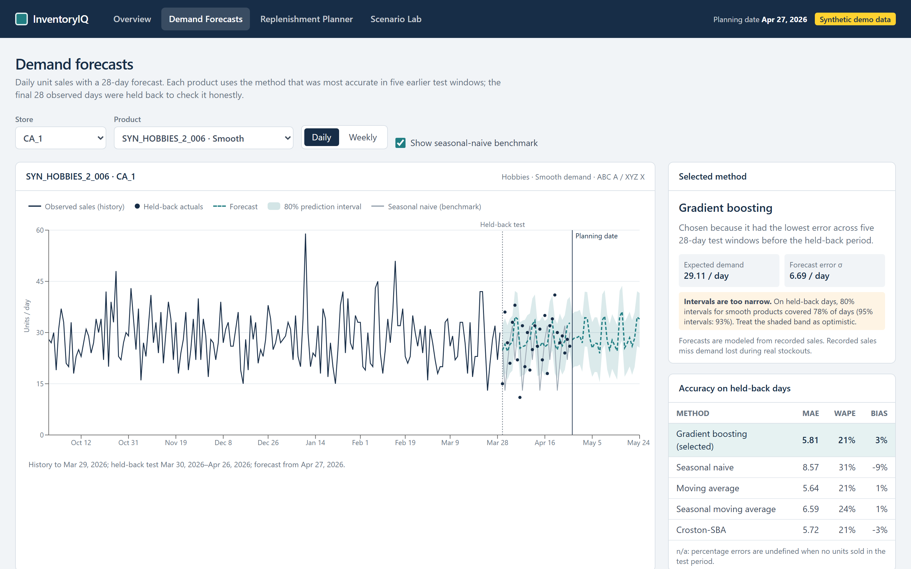
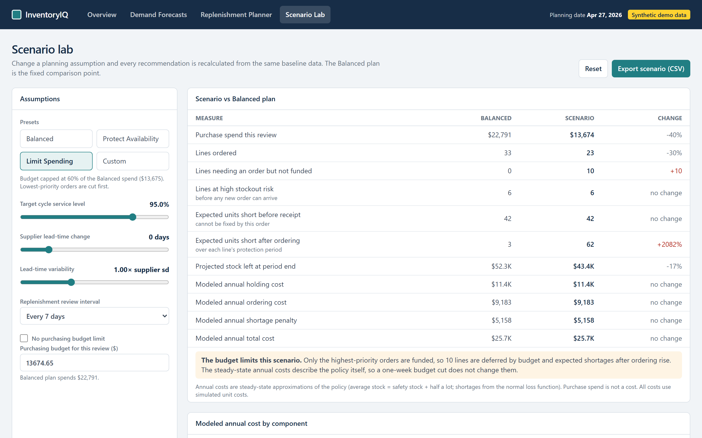

# InventoryIQ

### Inventory Forecasting & Replenishment Intelligence

An inventory planning system that uses historical sales analysis, demand forecasting, and replenishment calculations to evaluate purchasing decisions.


<sub>Screenshot of the running application on **synthetic demonstration data**. The findings below come from a separate analysis of the Walmart M5 dataset, which is not redistributed here.</sub>

**How it works:** sales history → demand forecast → safety stock and reorder point → purchase recommendation (case packs, minimum orders, supplier capacity, budget) → scenario comparison.

**[Code](src/inventoryiq/)** · **[Methodology](docs/methodology.md)** · **[SQL analysis](sql/README.md)** · **[Excel demo workbook](deliverables/synthetic/InventoryIQ_Analysis.xlsx)** · **[Run it locally](#run-it-locally)**

---

## Why I built this

I wanted to understand how inventory analysts turn sales data into purchasing decisions, not just reports. I built this to see how forecasting, stock levels, and supplier lead times work together to determine what should be reordered.

## Tools I used

| Tool | Used for |
|---|---|
| **Python** (pandas, NumPy, scikit-learn) | Data validation, forecasting, safety-stock math, inventory simulation |
| **SQL** (DuckDB) | Analytical tables, 12 business queries, 19 data-integrity checks |
| **Excel** | A workbook whose safety-stock, reorder-point and order-quantity cells are live formulas |
| **Next.js, React, TypeScript** | A local planning app that recalculates purchase recommendations instantly |
| **pytest, Vitest, Playwright** | Automated tests, including Python-vs-TypeScript calculation parity |

## What I did

- Analyzed five years of daily retail sales (the 30,490 product-store series of the Walmart M5 dataset) using Python and SQL.
- Evaluated five demand forecasting methods against held-back historical data.
- Built safety-stock, reorder-point and purchasing calculations with lead times, case packs, minimum orders, supplier capacity and budgets.
- Compared a simple reorder rule with forecast-based policies in a controlled 182-day simulation.

## Visual proof

All four screens below are genuine captures of the running app on synthetic demonstration data.

| Overview: which products are at risk | Demand Forecasts: forecast vs held-back sales |
|---|---|
|  |  |
| **Replenishment Planner: every order explained** | **Scenario Lab: what changes when assumptions change** |
|  |  |

## Key findings

From my analysis of the Walmart M5 sales dataset, combined with **simulated** suppliers, inventory and costs. These are model results, not a description of Walmart's actual operations. Exact figures are kept private; the summary below is qualitative. Anyone with authorized access to the dataset can reproduce the full results locally (`python -m inventoryiq.pipeline --source m5`, then `python scripts/build_results_md.py`).

1. **Forecasting helped, but only modestly.** On an untouched 28-day holdout, choosing a method per product clearly beat a seasonal-naive benchmark, but was only marginally better than a well-tuned moving average or gradient boosting. Across all ten stores, a single moving average did slightly better than per-product selection. Prediction intervals were too narrow.
2. **The first forecast-based policy failed its pre-planned test.** Its economic order quantities overloaded simulated supplier capacity and starved other products.
3. **The revised policy trades inventory for fewer orders.** It caps each order at 28 days of supply. On one earlier window held out from the redesign, it matched the simple reorder rule's service with fewer, larger orders and more inventory. It only costs less when processing a purchase-order line costs more than a break-even amount well below the simulated $4–$9. One window is not proof of real-world superiority, and its result in the window where it was designed is not independent.
4. **Supplier capacity shapes the plan.** At the planning date, part of the needed orders are deferred because simulated capacity cannot absorb a catch-up from the old policy's stock levels. Capacity goes to the highest-risk lines first, and the app explains every deferral.

The evaluation design and evidence labels are in [docs/methodology.md](docs/methodology.md). The screenshots show the same calculations running on synthetic data.

## What I learned

Forecast accuracy is only one input to a purchasing decision. Supplier capacity, order sizes and order-processing costs can matter just as much: a policy that orders in large lots can overload a supplier, and whether fewer, larger orders pay off depends on what an order actually costs to process. I would want real order-cost data before recommending a policy change.

## What I'd do next

Validate the planner against genuine supplier lead times, inventory snapshots and purchase-order records, replacing every simulated assumption with observed data.

---

## Technical implementation and setup

### What is where

| Component | Location |
|---|---|
| Data validation (30+ checks, blocking vs flagged) | [src/inventoryiq/validate.py](src/inventoryiq/validate.py), [docs/data_cleaning_rules.md](docs/data_cleaning_rules.md) |
| Forecasting and rolling-origin evaluation | [src/inventoryiq/forecasting/](src/inventoryiq/forecasting/), [src/inventoryiq/forecast_stage.py](src/inventoryiq/forecast_stage.py) |
| Safety stock, reorder point, constrained allocation (reference engine) | [src/inventoryiq/inventory/policy.py](src/inventoryiq/inventory/policy.py), [src/inventoryiq/planning.py](src/inventoryiq/planning.py) |
| Inventory simulation (lost-sales ledger) | [src/inventoryiq/inventory/simulation.py](src/inventoryiq/inventory/simulation.py), [src/inventoryiq/sim_stage.py](src/inventoryiq/sim_stage.py) |
| Browser engine (mirrors the Python reference) | [app/src/lib/engine/](app/src/lib/engine/) |
| SQL schema, integrity checks, 12 analyses | [sql/](sql/README.md) |
| Excel workbook builder and formula validation | [src/inventoryiq/excel_workbook.py](src/inventoryiq/excel_workbook.py), [Power Query scripts](excel/power_query/README.md) |
| Tests (golden hand calculations, leakage, parity, end-to-end) | [tests/](tests/), [app/tests/](app/tests/) |
| Methodology, assumptions, data dictionary | [docs/methodology.md](docs/methodology.md), [docs/assumptions.md](docs/assumptions.md), [docs/data_dictionary.md](docs/data_dictionary.md) |
| Release and publication audits | [scripts/release_audit.py](scripts/release_audit.py), [docs/publication_audit.md](docs/publication_audit.md) |

**Core formulas** (periodic review, lost sales): protection period P = E[L] + R; safety stock = z × √(P·σ² + μ²·Var[L]); reorder point = μ·P + safety stock; order up to reorder point + min(max(EOQ, μ·R), 28·μ); order quantity in whole cases, at least the MOQ. Supplier capacity, then budget, is allocated by risk priority (a transparent heuristic, not a proven optimum).

### Local app vs hosted demo

InventoryIQ runs **locally**. There is no hosted live demo, and no paid services, accounts or servers are needed. The app ships with synthetic demonstration data, so it runs straight from a clean clone. Reproducing the Walmart M5 results requires downloading the dataset yourself under its own terms ([docs/data_access.md](docs/data_access.md)).

### Run it locally

Requirements: Node.js 20.9+ and, for the analytics pipeline, Python 3.12+.

```bash
git clone https://github.com/<your-account>/inventoryiq-supply-chain-analytics.git
cd inventoryiq-supply-chain-analytics/app
npm ci
npm run build
npm run start            # open http://localhost:3000 (synthetic demo data)
```

On Windows PowerShell, use `npm.cmd` if script execution is blocked, or run `powershell -ExecutionPolicy Bypass -File scripts\setup_and_run.ps1` from the repository root.

**Python pipeline and tests**

```bash
python -m venv .venv
# Windows: .\.venv\Scripts\activate    macOS/Linux: source .venv/bin/activate
pip install -r requirements-dev.txt && pip install -e . --no-deps
python -m inventoryiq.pipeline --source synthetic     # full pipeline on generated synthetic data
python -m inventoryiq.pipeline --source m5            # needs the M5 CSVs in data/raw (about 15 minutes)
pytest -q
```

**App tests** (from `app/`): `npm run lint`, `npm run typecheck`, `npm test`, then `npx playwright install chromium` and `npm run test:e2e`.

**Windows note.** Playwright can be slow to shut down a server it started itself. Start the app first (`npm run start -- -p 3100`), then run the end-to-end tests in a second terminal. Restart the server after swapping the data in `app/public/data`.

### Known limitations

- **Censored demand.** Recorded sales are not true demand: stockouts hide lost sales.
- **Simulated operations.** Every supplier, stock, cost and purchase-order value is simulated.
- **Intervals.** Prediction intervals under-cover.
- **Model coverage.** Gradient boosting covers two of the ten stores.
- **Post-hoc design.** v2 was designed after seeing v1, and its only independent evidence is one earlier window.
- **Excel.** The workbook is generated with openpyxl and validated with the `formulas` recalculation engine. It has not been opened in Microsoft Excel during testing, and the Power Query scripts have not been run in Excel.

### License and data

Original code and documentation: [MIT License](LICENSE), copyright (c) 2026 Harjot Sandhu. The Walmart M5 dataset and anything derived from it stay under the dataset's own terms and are not redistributed here; see [THIRD_PARTY_DATA.md](THIRD_PARTY_DATA.md). Screenshots, the demo workbook and the demo video use synthetic data generated by [src/inventoryiq/synthetic.py](src/inventoryiq/synthetic.py).

<sub>Independent portfolio project by Harjot Sandhu. Not affiliated with Walmart, Kaggle or the M5 organisers.</sub>
