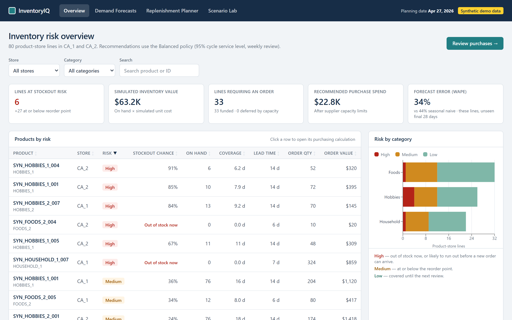
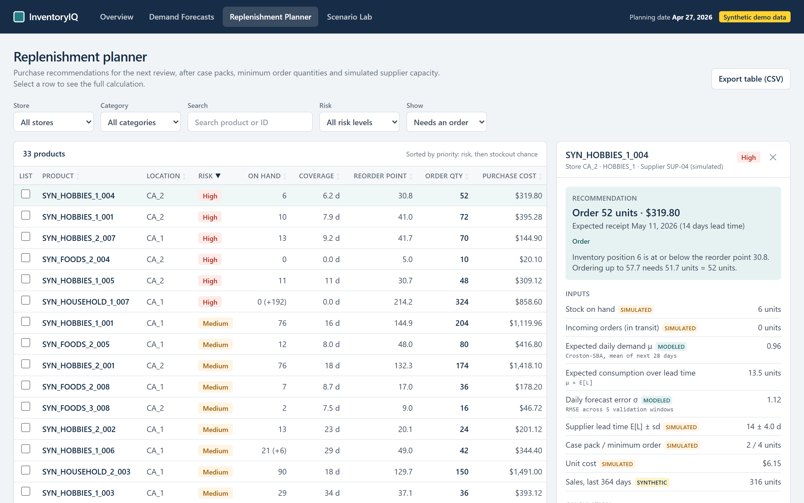

# InventoryIQ — Inventory Forecasting & Replenishment

An interactive inventory planning system that forecasts demand, identifies stockout risks, and calculates purchasing recommendations.

## Why I built this

I wanted to understand how inventory analysts turn sales data into purchasing decisions, not just reports. I built this to see how forecasting, stock levels, and supplier lead times work together to determine what should be reordered.

## Tools I used

- **Python** to clean five years of daily sales, test forecasting methods, and calculate safety stock and reorder points
- **SQL** (DuckDB) to build analytical tables, answer purchasing questions, and run data-quality checks
- **Excel** for a workbook whose safety-stock, reorder-point and order-quantity cells are live formulas
- **Next.js and TypeScript** for a local planning app that recalculates recommendations instantly

## What I did

- Analyzed historical retail sales using Python and SQL.
- Evaluated demand forecasting methods against historical data.
- Built safety-stock, reorder-point, and purchasing calculations.
- Compared inventory policies using a controlled simulation.

## Visual proof

*Screens from the working application, running on synthetic demonstration data.*

*Overview: which products are at risk of running out.*

*Demand Forecasts: forecast checked against held-back sales and a simple benchmark.*

*Replenishment Planner: every recommendation shows its inputs and math.*

*Scenario Lab: a budget cut and its effect on orders and shortages.*

## What I learned

Better forecasts alone did not improve availability. In my simulation using historical Walmart sales (with simulated suppliers and costs), a forecast-based policy only matched a simple reorder rule's service once its order sizes were capped to fit supplier capacity. It then placed fewer, larger orders and held more inventory. Whether that saves money depends on what each order costs to process, so supplier constraints and order costs mattered as much as forecast accuracy.

## What I'd do next

Validate the planner with genuine supplier lead times, inventory snapshots and purchase-order records instead of simulated ones.

## Links

- **[View GitHub](https://github.com/harjotsandhu24/inventoryiq-supply-chain-analytics)**
- **[Download Excel Analysis](https://github.com/harjotsandhu24/inventoryiq-supply-chain-analytics/blob/main/deliverables/synthetic/InventoryIQ_Analysis.xlsx)** (synthetic demonstration workbook)

Findings come from the author's analysis of the Walmart M5 dataset (Kaggle) using simulated suppliers, inventory and costs; numerical results are kept private. Screenshots use synthetic data.
